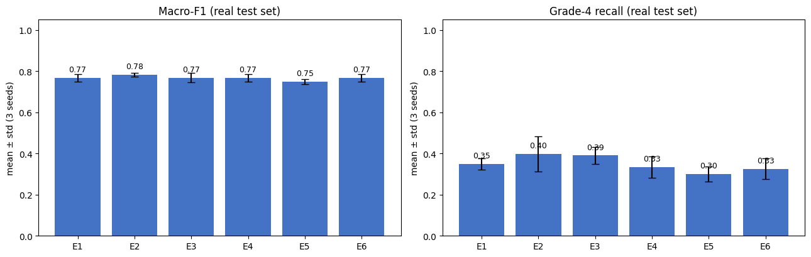
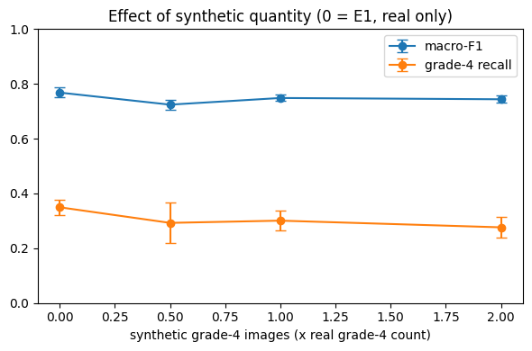
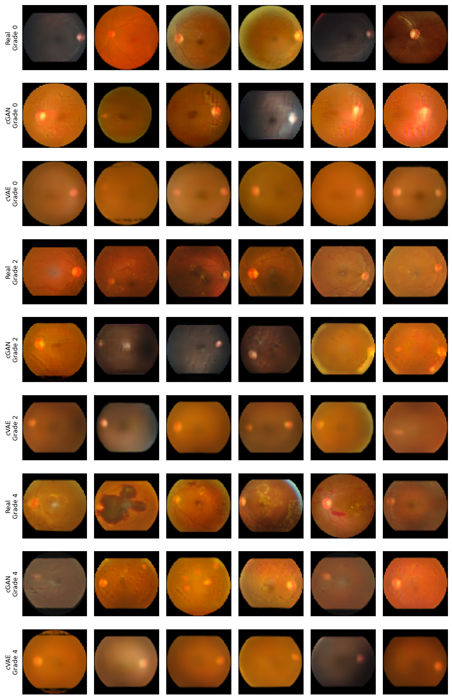
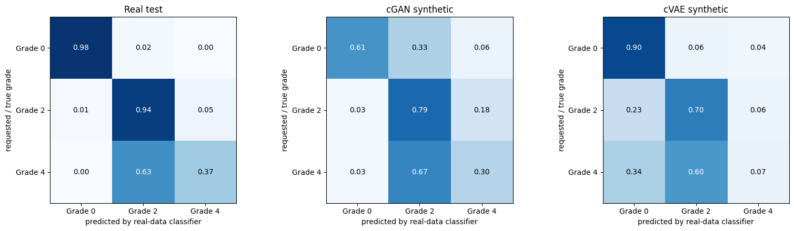
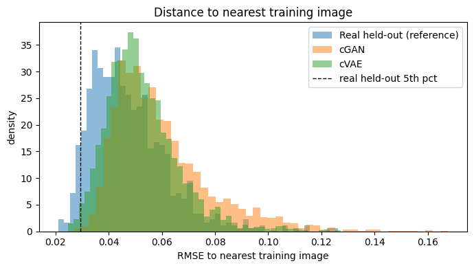
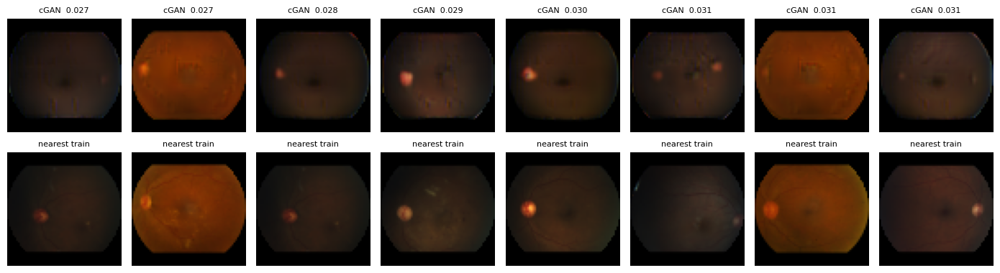

# Results

All numbers come from `notebooks/04_evaluation.ipynb`. The test set is 264 / 127 / 41 images (grades 0 / 2 / 4).
Classifier results are mean ± std over 3 seeds.

## 1. Downstream DR grading (ResNet-18, 30 epochs)
Synthetic / oversampled data adds 207 extra grade-4 images (ratio 1.0 = doubling grade 4).

| Exp | Training data | Accuracy | Macro-F1 | QWK | Recall G0 | Recall G2 | Recall G4 |
|---|---|---|---|---|---|---|---|
| E1 | Real only | 0.907 ± 0.007 | 0.768 ± 0.018 | 0.867 ± 0.016 | 0.977 | 0.940 | 0.350 ± 0.028 |
| E2 | Real + classical aug | 0.910 ± 0.007 | **0.782 ± 0.010** | **0.880 ± 0.009** | 0.979 | 0.934 | **0.398 ± 0.086** |
| E3 | Real + oversampling | 0.899 ± 0.010 | 0.767 ± 0.023 | 0.864 ± 0.019 | 0.975 | 0.906 | 0.390 ± 0.042 |
| E4 | Real + cVAE synthetic | 0.907 ± 0.005 | 0.767 ± 0.019 | 0.876 ± 0.002 | 0.973 | 0.953 | 0.333 ± 0.051 |
| E5 | Real + cGAN synthetic | 0.900 ± 0.005 | 0.749 ± 0.012 | 0.864 ± 0.004 | 0.972 | 0.942 | 0.301 ± 0.037 |
| E6 | Real + cGAN + classical aug | **0.911 ± 0.005** | 0.767 ± 0.019 | 0.871 ± 0.018 | 0.981 | 0.955 | 0.325 ± 0.051 |

### Ablation: amount of cGAN data (E5)
| Synthetic ratio | Macro-F1 | Recall G4 |
|---|---|---|
| 0.0 (E1) | 0.768 ± 0.018 | 0.350 ± 0.028 |
| 0.5 | 0.724 ± 0.017 | 0.293 ± 0.073 |
| 1.0 | 0.749 ± 0.012 | 0.301 ± 0.037 |
| 2.0 | 0.744 ± 0.013 | 0.276 ± 0.037 |

## 2. Fidelity and diversity (1000 synthetic images per grade)
FID / KID against the real training set; LPIPS = mean pairwise distance (higher = more diverse).
"Real held-out" (val + test) is the reference for what real images score.

| Source | Grade | FID ↓ | KID ×1000 ↓ | LPIPS diversity |
|---|---|---|---|---|
| Real held-out | all | 9.6 | 0.2 ± 1.2 | 0.209 |
| cGAN | all | **63.7** | **55.4 ± 5.5** | **0.219** |
| cGAN | 0 / 2 / 4 | 72.4 / 69.3 / 79.4 | 55.5 / 56.2 / 57.5 | 0.251 / 0.207 / 0.190 |
| cVAE | all | 119.2 | 138.7 ± 7.2 | 0.124 |
| cVAE | 0 / 2 / 4 | 115.6 / 127.2 / 140.6 | 136.8 / 157.0 / 161.0 | 0.127 / 0.112 / 0.111 |

## 3. Class consistency
Share of images that the E1 (seed 0) classifier assigns to the intended grade.

| Source | Overall | Grade 0 | Grade 2 | Grade 4 |
|---|---|---|---|---|
| Real test | 0.910 | 0.977 | 0.945 | 0.366 |
| cGAN | 0.564 | 0.611 | 0.785 | **0.297** |
| cVAE | 0.558 | 0.903 | 0.703 | 0.067 |

## 4. Memorisation
Nearest-neighbour pixel RMSE from each synthetic image to the training set.
The last column is the share of images closer to a training image than the 5th percentile of real held-out images.

| Source | Median NN RMSE | 5th pct | Min | Closer than real p5 |
|---|---|---|---|---|
| Real held-out | 0.0449 | 0.0293 | 0.0211 | 5.0 % |
| cGAN | 0.0555 | 0.0389 | 0.0268 | 0.1 % |
| cVAE | 0.0503 | 0.0343 | 0.0247 | 1.1 % |

## Other figures
- `class_distribution.png`, `real_samples.png`, `duplicate_check.png`: data preprocessing (notebook 01)
- `cgan_losses.png`, `cgan_real_vs_fake.png`: cGAN training (notebook 02)
- `cvae_losses.png`, `cvae_reconstructions.png`, `cvae_real_vs_fake.png`: cVAE training (notebook 03)
